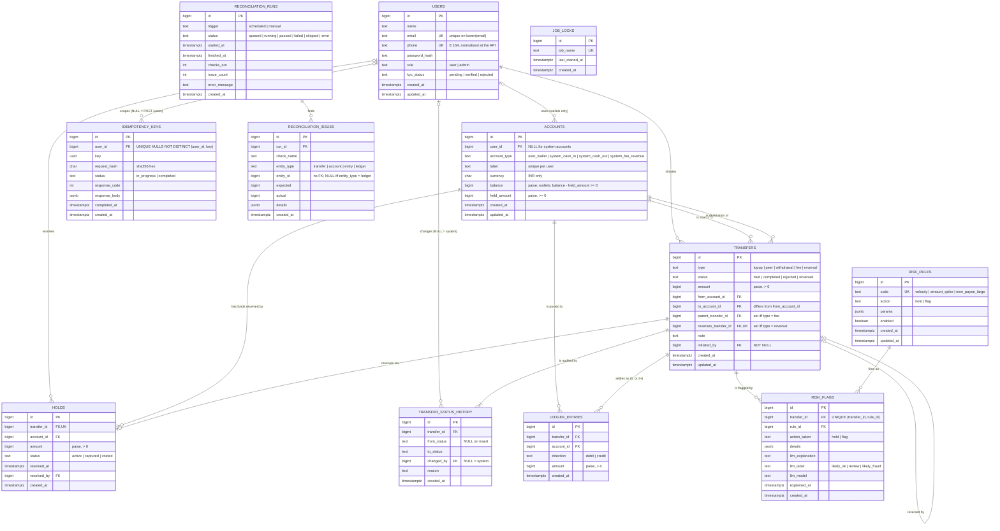

# Schema

The data model for Airtribe_WalletLedger: which nouns become tables and why, how they relate,
where each foreign key lives, and the ER diagram. `DESIGN.md` §3 is the source; this document
explains the decisions behind it.

Conventions for every table: plural `snake_case` name, singular column names,
`id BIGINT GENERATED ALWAYS AS IDENTITY PRIMARY KEY`, `created_at TIMESTAMPTZ NOT NULL DEFAULT
now()`. Money is `BIGINT` paise everywhere. Enumerations are `TEXT` columns with a `CHECK`
listing the allowed values.

## 1. Nouns

### Nouns that get a table

| Noun | Table | Why it is a table |
|---|---|---|
| User | `users` | A person who logs in. Has identity (email, phone), credentials, a role and a KYC status, and owns wallets. |
| Wallet | `accounts` (`account_type = 'user_wallet'`) | Holds a balance and is the thing money moves between. A user can have several (`label`: `main`, `savings`, …). |
| System account | `accounts` (`system_cash_in`, `system_cash_out`, `system_fee_revenue`) | Double entry needs a counter-leg for money entering, leaving or being earned by the platform. They're in the same table as wallets so that every ledger entry points at one `accounts` row, and so that "Σ all balances = 0" is a single query. |
| Transfer | `transfers` | The business event: "₹500 from A to B". It has a type, a lifecycle status and an initiator, and a fee or reversal links back to another transfer. |
| Ledger entry | `ledger_entries` | One debit or credit line against one account. Entries are the source of truth for balances, and they are append-only. |
| Hold | `holds` | A held transfer reserves funds before any entry exists. The reservation has its own lifecycle (`active` → `captured` / `voided`), resolver and timestamp, so it can't be just a column on `transfers`. |
| Status change | `transfer_status_history` | An audit trail: who changed which transfer from which status to which, and why. An append-only log is one row per change. |
| Idempotency key | `idempotency_keys` | Has to survive across requests and be unique per user. It stores the original response so a retry can replay it byte for byte. |
| Risk rule | `risk_rules` | Rule thresholds are data, so they can be tuned or switched off without a deploy. One row per rule. |
| Risk flag | `risk_flags` | A record that a rule fired on a transfer, with the values it observed and, later, the LLM's explanation and label. |
| Reconciliation run | `reconciliation_runs` | Each run has a trigger, lifecycle, timings and an outcome that the admin API reports. |
| Reconciliation issue | `reconciliation_issues` | One root-cause finding of a run: a check name, an entity, and expected vs. actual values. |
| Job lock | `job_locks` | One row per scheduled job, locked with `FOR UPDATE NOWAIT`, so a second scheduler instance can't run the same job at the same time. |

### Nouns that are not tables

| Noun | Where it lives | Why it is not a table |
|---|---|---|
| Currency | `accounts.currency CHAR(3)` with `CHECK (currency = 'INR')` | Single-currency system. A table would add a join that only ever returns one row. |
| Balance | `accounts.balance` | A cached sum of the account's entries, kept in the same transaction as the entries so the post-lock funds check reads one row. Reconciliation check 3 proves it matches the entries. |
| Held amount | `accounts.held_amount` | A cached sum of the account's `active` holds, needed in the same `CHECK` as `balance`. Reconciliation check 6 proves it matches. |
| Available balance | Computed: `balance - held_amount` | Derived from two columns of the same row, so storing it would let it go stale. |
| Account type | `accounts.account_type` with a `CHECK` | A fixed set of four values that the code branches on. Adding one needs code anyway. |
| Fee | A `transfers` row with `type = 'fee'` and `parent_transfer_id` | A fee is money moving from a wallet to `fee_revenue`, which is exactly a transfer. |
| Reversal | A `transfers` row with `type = 'reversal'` and `reverses_transfer_id` | Also a transfer: mirrored entries, its own status and initiator. |
| Direction | `ledger_entries.direction` (`debit` \| `credit`) | Two fixed values. |
| Role, KYC status | `users.role`, `users.kyc_status` | One current value per user, from a fixed set. There's no role-permission matrix to model. |
| Admin | A user with `role = 'admin'` | Same identity, login and audit columns as any other user. |
| Statement | A query over `ledger_entries` for one account | Read-only and paginated. The rows already exist. |
| Counterparty | The other side of a `transfers` row | Q&A finds it by joining transfers to `accounts` and `users`. Nothing new to store. |
| Session / access token | Stateless JWT | Tokens are verified by signature. With no refresh tokens and no revocation list, there is nothing to persist. |
| Request ID | `X-Request-ID` header and logs | Correlates one HTTP request. The idempotency key covers what must be persisted about a request. |
| Q&A question | Not stored | Answered from the ledger at request time. Nothing in the brief asks for history. |
| LLM explanation and label | Columns on `risk_flags` | Exactly one per flag, always read together with it. |

## 2. Relationships and cardinality

Each relationship is read both ways. "0..1" means optional and at most one; "0..*" means any
number including none; "1" means exactly one.

| # | Relationship | Read one way | Read the other way | FK lives on |
|---|---|---|---|---|
| R1 | users – accounts | A user owns 0..* accounts (its wallets). | An account belongs to 0..1 user: wallets have exactly 1, system accounts have none. | `accounts.user_id` (nullable) |
| R2 | accounts – ledger_entries | An account has 0..* entries. | An entry is posted to exactly 1 account. | `ledger_entries.account_id` |
| R3 | transfers – ledger_entries | A transfer has 0 entries while `held` or `rejected`, and 2 or more once it settles (every current flow writes exactly 2: one debit, one credit). | An entry belongs to exactly 1 transfer. | `ledger_entries.transfer_id` |
| R4 | accounts – transfers (from) | An account is the source of 0..* transfers. | A transfer comes from exactly 1 account. | `transfers.from_account_id` |
| R5 | accounts – transfers (to) | An account is the destination of 0..* transfers. | A transfer goes to exactly 1 account, never the same as its source. | `transfers.to_account_id` |
| R6 | transfers – transfers (fee) | A transfer has 0..* fee transfers (in practice 0 or 1: withdrawals only). | A fee transfer has exactly 1 parent. Every other type has none. | `transfers.parent_transfer_id` (nullable) |
| R7 | transfers – transfers (reversal) | A transfer is reversed by 0..1 reversal, enforced by `UNIQUE`. | A reversal reverses exactly 1 transfer. Every other type reverses none. | `transfers.reverses_transfer_id` (nullable, `UNIQUE`) |
| R8 | users – transfers (initiator) | A user initiates 0..* transfers. | A transfer is initiated by exactly 1 user. | `transfers.initiated_by` |
| R9 | transfers – holds | A transfer has 0..1 hold (only one that was ever `held`). | A hold reserves funds for exactly 1 transfer. | `holds.transfer_id` (`UNIQUE`) |
| R10 | accounts – holds | An account has 0..* holds. | A hold reserves funds on exactly 1 account (the sender's). | `holds.account_id` |
| R11 | users – holds (resolver) | A user (an admin) resolves 0..* holds. | A hold is resolved by 0..1 user: none while `active`. | `holds.resolved_by` (nullable) |
| R12 | transfers – transfer_status_history | A transfer has 1..* history rows: the insert writes the first. | A history row describes exactly 1 transfer. | `transfer_status_history.transfer_id` |
| R13 | users – transfer_status_history | A user makes 0..* status changes. | A status change was made by 0..1 user. NULL means the system did it. | `transfer_status_history.changed_by` (nullable) |
| R14 | users – idempotency_keys | A user has 0..* keys. | A key belongs to 0..1 user. NULL is the scope for unauthenticated `POST /users`. | `idempotency_keys.user_id` (nullable) |
| R15 | transfers – risk_rules, through risk_flags | A transfer has 0..* flags, at most one per rule (`UNIQUE (transfer_id, rule_id)`). | A rule has fired on 0..* transfers. | `risk_flags.transfer_id`, `risk_flags.rule_id` |
| R16 | reconciliation_runs – reconciliation_issues | A run has 0..* issues (0 when it passed). | An issue was found by exactly 1 run. | `reconciliation_issues.run_id` |
| — | reconciliation_issues – any entity | An issue points at 0..1 transfer, account or entry, or at the whole ledger (`entity_id` NULL). | — | **No FK**: `entity_type` + `entity_id`, see below |

`job_locks` and `risk_rules` stand alone: nothing references `job_locks`, and `risk_rules` is
only referenced by `risk_flags`.

## 3. Foreign key placement

- **On the "many" side**, always: an entry points at its account and transfer, a transfer at
  its two accounts, an issue at its run. The "one" side never stores a list.
- **A one-to-zero-or-one relationship is an FK plus `UNIQUE` on the dependent row.**
  `holds.transfer_id UNIQUE` makes "at most one hold per transfer" a database fact.
  `transfers.reverses_transfer_id UNIQUE` makes "a transfer can be reversed once" one too, and
  a second reversal attempt becomes a constraint violation (`409 ALREADY_REVERSED`) instead of
  a race the code has to win.
- **Self-references live on the newer row.** A fee points at its parent and a reversal points at
  its original, both created later. That way the original row is never updated to add a
  link: its only change is `status`.
- **A nullable FK means "optional", and a `CHECK` ties it to the type.** `accounts.user_id IS NOT
  NULL` exactly when `account_type = 'user_wallet'`; `reverses_transfer_id IS NOT NULL` exactly
  when `type = 'reversal'`; `parent_transfer_id IS NOT NULL` exactly when `type = 'fee'`.
- **No `ON DELETE CASCADE` anywhere.** Money and audit rows are never deleted, and the default
  (`NO ACTION`) makes an accidental parent delete fail loudly.
- **`reconciliation_issues.entity_id` has no FK on purpose.** It may point at different tables
  depending on `entity_type`, and the orphan check reports rows whose parent is *missing*. An
  FK would forbid recording the very corruption the job exists to find.
  `CHECK ((entity_type = 'ledger') = (entity_id IS NULL))` keeps the pair consistent: a ledger-wide
  issue has no entity, every other issue has one.
- **`holds.account_id` repeats `transfers.from_account_id`.** It's kept so that reconciliation
  check 6 (`held_amount` = Σ active holds per account) groups `holds` alone, without a join.
  The posting code writes both from the same locked row.
- **`transfers.from_account_id` / `to_account_id` repeat what the entries say.** They exist so
  risk rules and Q&A can query transfers without joining entries, and so held transfers (which
  have no entries yet) still know their accounts. Reconciliation check 2 proves the entries
  agree with them.

## 4. Constraints settled in review

These are decided here, beyond what `DESIGN.md` §3.2 lists:

| Column or rule | Constraint | Why |
|---|---|---|
| `transfers.initiated_by` | `NOT NULL` | Every flow has a user: owners top up and transfer, admins reverse. Nothing creates transfers on its own. |
| `users.phone` | `NOT NULL UNIQUE`, stored in E.164 (`+919876543210`); the 1.2 migration adds `CHECK (phone ~ '^\+[1-9][0-9]{7,14}$')` | `POST /users` requires a phone. The API validates and normalizes it before insert, so `98765 43210` and `+91-9876543210` can't slip past `UNIQUE` as two different strings. The `CHECK` makes the database reject anything that isn't E.164, even if a write bypasses the API. |
| `holds.amount` | `CHECK (amount > 0)` | Same rule as `transfers.amount` and `ledger_entries.amount`: a zero hold reserves nothing. |
| Per-transfer balance (deferred trigger) | At commit, Σ debits and Σ credits for the transfer must each equal `transfers.amount` | Debits = credits alone would accept a ₹100 transfer posted as ₹200 each way. The trigger checks totals only; it doesn't restrict how many entries a transfer has. |
| `risk_flags.action_taken` | `CHECK (action_taken IN ('hold', 'flag'))` | The same two actions `risk_rules.action` allows. |
| `reconciliation_issues.entity_id` | Nullable; `CHECK ((entity_type = 'ledger') = (entity_id IS NULL))` | A ledger-wide issue (the global balance check) has no single entity. |

## 5. ER diagram

The diagram can't express the rules that hold across columns. Those are `CHECK` constraints
and triggers, listed in `DESIGN.md` §3.2–3.3 and tested in step 1.6:

- a wallet has a user and a system account doesn't;
- there is exactly one row per system account (a partial unique index);
- available balance is never negative;
- a fee has a parent and a reversal has an original;
- at commit, each transfer's debits and its credits each sum to `transfers.amount`.
